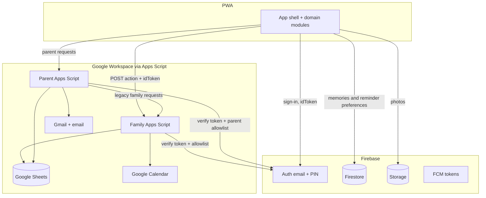

# Architecture — Sheets vs Firebase

Wong’s Nest and Parents’ Corner use Firebase and two separate Apps Script services. Keep one authoritative writer for each feature.



---

## Rule of thumb

| Put it in **Firebase** when… | Put it in **Sheets + GAS** when… |
|------------------------------|----------------------------------|
| Needs **live multi-user** updates (photo album) | Is a **ledger / log / list** parents may open in a spreadsheet |
| Is a **binary file** (images) | Needs **Gmail**, **Calendar**, or **email** (bank scan, digests, approval links) |
| Is **device/session** state (FCM tokens) | Needs **server-side adult gates** without trusting the client UI alone |
| Auth identity | Batch jobs and time-driven triggers in Apps Script |

**Identity bridge:** Firebase Auth is the only login. GAS never trusts `user` from the client; it verifies `idToken` and maps email → member name.

---

## Ownership map (source of truth)

### Firebase (sole owner)

| Data | Where | Why |
|------|--------|-----|
| Login | Auth | Family accounts, PIN passwords |
| Memories metadata | Firestore `memories/` | Realtime album; images already in Storage |
| Memory images | Storage `memories/{email}/` | Large blobs; not Sheets |
| Reminder settings / device tokens | Firestore `users/{email}` / `notificationDevices/{hashedDeviceId}` | Account preferences / current device targeting |

**Client:** write/read via Firebase SDK + security rules.  
**GAS:** must **not** create memories. Reject `add_chat_message` / `add_memory`. `get_all` must **not** return chat or memories. Chat has been removed from the app.

### Google Sheets + Apps Script (sole owner)

| Sheet / system | Feature | Why Sheets/GAS |
|----------------|---------|----------------|
| Expenses, Budgets, RecurringExpenses | Money ledger | Spreadsheet audit, formulas, bank-email import |
| ToDo | Tasks | Simple rows + morning digest; Reward Member preserves the first completion recipient |
| Habits, HabitLogs | Daily practice | Server-derived member and one log per habit/member/day |
| RewardRules, RewardLedger, Companions | Companions and stars | Parent-selected rules, immutable earning/purchase IDs, authenticated member profiles |
| Birthdays | Dates | Digest + calendar-style lists |
| Travel | Trip log | Lat/lng list for map |
| Fertility, Appreciations, LoveCheckins, IntimacyLog, BucketList | Us / parents | Private logs; adult allowlist in GAS |
| Calendar (sheet mirror) + **Google Calendar API** | Events / schedules | Real calendar + family calendar ID |
| Log | Write audit | Debug trail |
| Gmail | PayLah / bank scan | Only Apps Script can read mailbox |
| MailApp | Digests, expense approval | Workspace email |

**Client:** `gasRequest` / `gPost` with Firebase `idToken`.  
**Never** put chat/memories here.

### Explicitly not dual-homed

| Feature | Was | Now |
|---------|-----|-----|
| Chat | Historically Sheets, then Firestore | **Removed from the app** |
| Memories | Sheets + Drive, then dual Firestore | **Firestore + Storage only** |
| Expenses / Us / fertility | Sheets | **Sheets only** (no Firestore collection) |

---

## Request paths

```
loadData()     → POST { action: "get_all", idToken }  → GAS → Sheets (+ Calendar)
gPost(note)    → POST { action: "write", note, idToken, … } → GAS → Sheets / Calendar
submitMemory   → Storage (optional image) + Firestore only
```

`applyDashboardPayload` **must preserve** `data.memories` from Firestore listeners and ignore any legacy GAS fields for those keys.

---

## Security layers

1. **Firebase Auth** — who is signed in.  
2. **Firestore / Storage rules** — family email allowlist; memory owner checks; Chat paths denied.
3. **GAS** — verify ID token + `ALLOWED_EMAILS` + `ADULT_EMAILS` for Us/fertility/intimacy.  
4. **Spreadsheet ACL** — who can open the sheet in Google Drive (especially IntimacyLog / Fertility).

Adult UI hiding is **not** security; GAS empty payloads + write deny are.

---

## When to move something

| Move **to Firebase** if… | Keep on **Sheets** if… |
|--------------------------|-------------------------|
| Users complain about stale multi-device UI | You open it in Sheets weekly |
| Needs offline-first document sync | Depends on Gmail/Calendar triggers |
| Heavy realtime collaboration | Batch nightly jobs are enough |

**Do not** migrate expenses/budgets to Firestore without a plan for bank-email import and spreadsheet review. **Do not** put intimacy/fertility only in Firestore without hardening rules (adult-only collections) and accepting loss of easy sheet export.

---

## Optional: old Sheets `Memories` tab

Historical rows may still exist in the spreadsheet. The app no longer reads or writes them. To migrate once:

1. Export the `Memories` sheet.  
2. For each row, create a Firestore `memories` doc (and re-upload images to Storage if URLs are Drive-only).  
3. Archive or hide the sheet tab.

---

## File map

| File | Backend role |
|------|----------------|
| `js/app.js` | App initialization, navigation and remaining forms; shared globals retained during incremental extraction |
| `js/session.js`, `js/api.js`, `js/status.js` | Account reset, authenticated transport, bounded requests and connection/refresh status |
| `js/calendar.js`, `js/money.js`, `js/memories.js` | Calendar views, money views, Firestore/photo recovery and memory archive |
| `js/modals.js` | Generic dialog focus trapping, Escape, backdrop dismissal and focus restoration |
| `Code.js`, `gas/auth.js`, `gas/calendar.js`, `gas/tasks.js`, `gas/money.js`, `gas/rewards.js` | Apps Script API, Sheets/Calendar/Gmail handlers and extracted money/reward helpers; no Firebase-owned persistence |
| `firestore.rules` / `storage.rules` | Firebase access control |
| `index.js`, `reminder-functions.js`, `reminder-plan.js` | AI extraction, validated reminder settings, scheduled FCM reminders and upload cleanup |
| `firebase-messaging-sw.js` | PWA cache + background push |
| `BRAND.md` | Wong’s Nest brand and design system |
| `css/styles.css` | Design tokens, typography, dark mode, responsive layout |
| `assets/nest-mark.svg`, `assets/nest-icon.svg` | Nest emblem and app icon masters |
| `css/nest.css`, `js/nest.js` | Current visual tokens, responsive shell, icons and page headings |

---

## Brand & Design System Governance

All UI development follows [BRAND.md](BRAND.md), Wong’s Nest version 2.0. The responsive shell and navigation are in `js/nest.js`; theme and component styling are in `css/nest.css`, loaded after the original base components. The nest emblem replaces the previous H-shaped mark.

Use semantic colour tokens, Nunito headings, DM Sans body text, and accessible SVG navigation. Desktop groups destinations into family activities, memories and parent tools. Mobile provides Home, Plan, Tasks, Nest and More. Existing adult gates and server checks remain authoritative. Rebranding does not change Firebase project IDs, Apps Script URLs, storage paths, or saved preference keys.


## Reward consistency

Rewards are owned by Apps Script and Sheets, under the same script lock as task and habit writes. Save the completion before awarding stars. Deterministic earning IDs allow retries to recover missing awards without duplicating them; an Everyone task stores the first recipient alongside completion in ToDo column M. Habit rewards key on the definition ID, actual member and Singapore date, surviving log deletion.

Purchases use the fixed server catalog, verified caller identity and current ledger balance. A deterministic member/item ID makes retrying a purchase harmless. Profiles can only equip owned accessories. Only parents can choose reward rules; client-supplied member, price or star values never control an award or purchase. Balances include spending; the cooperative garden uses lifetime earned stars. No rewards are stored in Firebase or granted offline.


## Session isolation and save feedback

Every account change clears client data, parent-only rendered content, forms, cached tokens, Firebase listeners and uncommitted Undo actions. GAS responses are accepted only by the originating session. Dashboard request generations prevent older reads from replacing newer refreshes or completed writes. Accepted dashboards replace private lists; child accounts always clear parent-only fields. School uploads, extraction and original-image requests also reject results from closed or reset reviews.

Forms clear and report success only after a confirmed backend save. Refresh returns a success flag. Calendar deletion follows the five-second deferred Undo mechanism: Undo cancels the write, expiry commits it, and a failed foreground commit restores the local item with a warning. Leaving the page retains an account-scoped unconfirmed deletion receipt containing identifiers only; no beacon is sent. Resume/reload shows pending status and fresh dashboard data. Explicit retry uses fresh foreground authentication, and backend confirmation retires the receipt. Stop retrying clears the pending intent and refreshes the saved state. Signing out during the Undo window cancels the uncommitted deletion.


## Scheduled habits and daily checklist

Habits columns G–K store Schedule, Weekdays, WeeklyTarget, State and UpdatedAt. Blank legacy values mean daily/active. Habit IDs and logs survive edits, pausing and archiving; the legacy delete endpoint now archives. Shared completions use the verified child identity or a parent-validated `log_member`. Server schedule checks control reward eligibility; weeks run Monday–Sunday in Singapore, counting distinct completion dates. The client helpers are in `js/habits.js`.

Dashboard `completedTasks` retains ordinary completed tasks for the child’s day view and uses the same verified-member filter as open tasks. The family milestone selection is owned by the `FamilyGoal` Sheet; its fixed server catalog does not alter the earning ledger or balances.

## Reminders and recovery

`updateReminderSettings` validates family identity, account preferences and device bindings. One installation/token binds to one active account. A parent-authenticated opt-in provisions a matching secret in GAS Script Properties; scheduled snapshot requests use timestamped HMAC signatures. `sendFamilyReminders` checks Singapore time and quiet hours every 15 minutes, filters assignments and habit schedules, then claims one account/day delivery receipt transactionally. FCM uses data-only payloads; the service worker checks its persistent active account, serializes delivery, suppresses repeated IDs and checks the account again on notification click. `users` preferences and device/receipt collections are server-written; retired Chat paths are denied.

`js/operations.js` retains only a payload digest and UUID until confirmation. GAS scopes the key to verified email/action, validates its fingerprint under the script lock, and recovers from resource or operation-ledger response loss. Calendar uses a deterministic native event ID and recovers HTTP 409 conflicts; other creates store their ID/fingerprint in appended columns. Legacy requests without operation IDs remain supported.

`js/memories.js` keeps the draft/upload on metadata failure and confirms uncertain writes by reading its stable document ID. Photo retries renew object metadata; cleanup uses object generation and metageneration preconditions after checking for a committed document. Latest memories stay live and older pages use Firestore cursors with deduplication. Draft state and listeners reset on account changes.

## Navigation, recovery and verification

Parents use Plan; children use Habits as their primary day-to-day destination. Child Home still combines their assigned/shared events, tasks and scheduled habits. Chat has no current UI or write pipeline; retired Chat documents and attachments are deleted, and access is denied.

Domain scripts load before the app initializer and continue sharing its existing globals. This is an incremental extraction, not a backend migration. Apps Script uploads `Code.js` plus `gas/*.js` together; the test harness loads the same sources. Calendar preparation reconciliation uses the script lock, updates future open tasks after rescheduling, retires cancelled preparation, and preserves completed history and manual deletions. Failed Calendar reads abort the dashboard instead of cancelling tasks. Money and coordinates reject non-finite/out-of-range input.

`js/api.js` rejects offline writes before transport; rewards are never queued. Token acquisition and fetch share an abort deadline (45 seconds for reads, 120 for writes). An offline/last-refreshed banner describes the accepted dashboard for the current session. A fresh session clears that timestamp. Generic modals have named dialog semantics, a Tab loop, Escape/backdrop dismissal through one path, and focus restoration. Selection chips use keyboard-operable buttons. Reduced-motion companion styling remains enabled.

CI runs Node regressions, Chromium failure flows and actual Firestore/Storage emulator rule tests on pushes and pull requests. Manual production deployment reruns those checks and deploys only from main through the production environment. Traces are retained on browser failures. See `docs/testing-and-deployment.md` for commands and environment/credential setup.

## Two app builds and domains

`family.marcusw.xyz` hosts family planning, tasks, school review, habits, rewards and memories; `parents.marcusw.xyz` hosts money, Just us and Wellbeing. `index.html` is the shared source template; `scripts/build-apps.cjs` excludes the other app’s screens/modals from each build. Parent Home is in `js/parents.js`. Mode is fixed in the rendered HTML, not a query-string switch. Frontend mode does not grant access: backend parent endpoints and writes still verify identity and allowlist.

`get_family_dashboard` skips private-parent sheet reads and filters family activity categories. `get_parent_dashboard` rejects children/outsiders before reading any sheet and does not call Calendar/reconciliation. The existing `get_all` endpoint remains for compatibility. Source globals still load some shared/legacy function definitions; incremental extraction continues without duplicating records.

The controlled Pages release builds both outputs. Cloudflare Workers in `hosting/` map each requested domain to its static Pages artifact path. They accept only static GET/HEAD paths, never proxy application APIs, and do not forward auth/cookies/body/personal query to the static origin. Parent app loads Firebase Auth only and uses `parents-sw.js`; family keeps its Firebase services and reminder worker. Each origin has an independent login/cache. Backend ownership is unchanged.

Family companion visits are in the `companions` route: all family members can view names, species and equipped accessories, with greeting animations and no controls for editing other members. Habit star allocations, task reward rules and family goal selection live in the parent-only `reward-admin` route within Wong’s Nest. Private finance stays in Parents’ Corner. Backend reward ownership and parent authorization are unchanged; session reset clears both pages.

## Family dashboard loading

The family client requests `get_family_core` first. It returns tasks, habits, companions and family records without calling Calendar or calendar-task reconciliation. Once rendered, `get_family_calendar` loads events, reconciles preparation tasks, and returns updated task lists. Calendar has a separate loading/error state; errors never mean there are no events. Account/session and dashboard generation checks reject late hydration after a save, refresh or account change. Normal ToDo reads acquire a script lock only when legacy IDs or headers need migration.

The family and parent apps use separate Apps Script services. Family requests use the standalone family project; legacy family requests on the original service forward to it. See `docs/family-backend-separation.md` for routing, lock ownership and deployment order. The authoritative spreadsheet remains shared.

## Habit assignments

One habit ID may belong to a selected subset of family members. The Habits Member cell preserves legacy single names and Everyone, or stores comma-separated selected names. API responses include a normalized `members` array. Parents can change assignments while preserving ID/history/reward rules; children can create or edit only a habit solely assigned to themselves. Read filtering and logging enforce assigned membership on the server. Completion logs, weekly counts and reward earn IDs remain per person. Reminder planning also filters by assigned members.

## Expense and calendar identity

Expense rows use immutable IDs (G), operation fingerprints (H), and deletion status (I). Deleted rows are retained for retry recovery and excluded from all spending totals/reports. Bank approvals derive their destination ID from the signed pending ID. Legacy row-number delete requests must refresh instead of targeting a guessed record.

Calendar REST reads expand recurring instances. Recurring event IDs are `instance:<REST ID>`; one-off IDs remain legacy iCalUIDs for existing links. Series iCalUIDs are metadata, never a recurring occurrence mutation target. Moves preserve elapsed timed duration or the all-day date span. Generated preparation keys use the occurrence ID and retain historical task identity when migrating a matching legacy due date. See `docs/p1-fixes-2026-10-15.md`.


## Preparation and partial-data recovery

The family service owns the Calendar read/reconciliation critical section (`calendarPreparation_`), using the same script lock as family writes with a 30-second wait. Browser calendar reads can return events with `preparationState: error`; the UI warns that preparation needs another refresh. Calendar preparation is a separate signed action; reminder snapshots read only persisted tasks, habits and habit logs.

The existing 15-minute Firebase reminder job requests signed preparation and then an independent snapshot when reminder profiles are due. The original service verifies its server-only HMAC and forwards the signed timestamp to the family service. Family validates freshness and asks the fixed original `verify_reminder_snapshot` endpoint to verify the signature, then performs the requested preparation or independent snapshot read. Preparation has its own deadline; failure does not block independent reminders, and stale automatically generated Calendar packing tasks are excluded from degraded deliveries. The nightly Apps Script digest also requests this bridge before reading tasks. No secret is copied into browser assets or the family project; bridge verification never returns household data. Existing reminder opt-in/bridge configuration is required; no new scheduled trigger is needed.

School rows are validated independently on reads. Damaged rows remain in SchoolAnnouncements for repair but are excluded from displayed plans. Calendar ownership links are retained even when notice details are damaged. Parent payloads include `dataWarnings`; children receive no damaged-record diagnostics. The warning banner clears on account/session reset.


Memories start with a live 50-item query. Paging extends a live timestamp range through the oldest loaded document snapshot (`endAt`); new items cannot evict a previously loaded boundary, and old edits/deletions remain live. Account/session and listener revisions protect replacement subscriptions. Rules validate new metadata and complete owner edits; malformed legacy values normalize on read. Existing legacy image references may remain unchanged on owner edits; new/replaced images must match the owner and UUID document path.

ReminderDeliveries now stores per-token-hash receipts with stable reminder identity, expiring after seven days. Confirmed successes and permanently invalid devices are not retried. Transient failures are retried independently, and only the holder of the current lease can finalize its receipt. Legacy account-level sent receipts remain honored during rollout. An uncertain transport/receipt can still cause a device retry; stable worker reminder IDs suppress duplicate display.


## App-shell and validation recovery

Both service workers import `js/pwa-cache.js`. Install must cache the complete shell before activation. Network-first reads cache only successful responses with the expected HTML/JS/CSS MIME type. Matching release-version query keys map to that worker's precache; other revisions do not silently reuse it. HTML fallback is limited to navigation and invalid cached HTTP responses are rejected. Firebase compat 9.23.0 is bundled under assets (with its license and provenance) and included in each app's offline shell; parent startup needs only App/Auth. Offline startup requires an earlier successful online install; authentication, server reads and writes still require connectivity. No offline completion/reward queue is introduced.

Money write boundaries use full-number and allowlist validators, and celebration dates are checked against real calendar dates. Free text is escaped through `schoolCell_` before Sheets writes. Signed bank corrections preserve the pending record on invalid input. Legacy bad recurring rows are skipped rather than interpreted as partial numbers.


## Timing and workload diagnostics

`gas/performance.js` owns request-local POST timing context and wraps existing domain functions. `perfReadRows_` counts existing range reads without requesting additional data. Fixed-label durations, stage-inclusive read counts and Calendar page/event counts are logged once per POST; adult responses also carry `_performance` metadata, removed from the application payload after the transport records it. This is operational metadata, not a new persistence owner or write path.

`js/performance.js` keeps up to 200 sanitized numeric samples in memory, cleared on account/session reset. Parents can open More → Loading check and explicitly download a report. Browser token/network/read/render times and readiness/startup measurements remain separate. No records, identity fields or URLs enter the diagnostic schema. `scripts/performance-report.cjs` aggregates browser exports or timing-only Cloud Logging JSONL with endpoint/stage percentiles. See `docs/performance-measurements.md` for interpretation and limits.

### Deferred photo services (15 October 2026)

`js/firebase-features.js` loads the pinned Firestore and Storage browser libraries on demand, shares concurrent requests, and permits retry after a failed or timed-out download. Home does not attach a Memories listener. Opening Memories starts its listener after database initialization; navigation and account generation checks prevent a delayed load from attaching a background listener. Saving a memory initializes the database independently of navigation; a photo or school attachment initializes Storage. Auth, Functions and Messaging retain their existing startup behavior so reminder device/account rebinding continues. The service worker still precaches photo libraries for offline use: this reduces startup execution, not total offline installation bytes.

### Dashboard history and read bounds (15 October 2026)

Core and Calendar responses include the latest 50 `completedTasks` and `completedTaskHistory.nextCursor`. `get_completed_tasks` is a family-owned POST read, forwarded by the legacy service; Firebase verification and `getTodos` ownership filtering run before keyset pagination. The cursor contains only completion time and permanent task ID. New completions and deleted boundary records do not shift later pages. Tasks offers Older/Newer navigation; it retains one page plus cursor positions, preserves it on failure, and discards late responses after refresh/account changes. Search applies to the displayed page. Existing linked `schoolTasks` remain complete to preserve dated plans and packing status.

A core response shares one request-local SchoolAnnouncements row snapshot between plan parsing and damaged-record warnings. There is no global cache: writes, ID migrations and Calendar reconciliation always re-read authoritative data. Activity reads at most 100 rows per batch backwards until it finds 50 relevant unique rows, continuing through filtered/duplicate rows and the legacy log as needed. This preserves the previous log precedence, filtering and synthesized task/habit entries. Diagnostic counters include actual range reads and rows fetched.

Limits: task pagination reduces response/browser history size, but still scans the ToDo sheet to sort/filter each request. Reward totals still use the complete ledger. Habit history remains a 45-day output window, and school plans/linked tasks remain unbounded; narrowing these needs separate archive/date loading so daily plans and reward totals remain correct. Functions/Messaging startup is also unchanged to preserve reminder account rebinding. These are remaining parts of performance item #2, not measured latency claims.

### Habit and school archives (15 October 2026)

Family clients opt into compact core payloads with `archive_version:1`. Older clients retain full notice/notes payloads during rollout. The compact core includes all unfinished school reviews and the newest 20 published **summaries**, without original source text, attachments or task detail. A parent opens `get_school_plan` to read one complete validated notice; old notices remain accessible through `get_family_archive` (`kind:school`, 20 summaries/page). Child denial happens before reading the source sheet. Calendar ownership links and linked school tasks still use complete authoritative records, independent of archive paging.

Habit progress retains the existing 45-day date window. Core log records omit notes; full notes and older entries load through `get_family_archive` (`kind:habits`, 50 entries/page, selected habit/person). Child identity overrides requested person filters before results are paged. Archive cursors contain a sort key and permanent ID; deleting a boundary row does not shift later records. Only the displayed page and cursor positions are held by the dialog. Close/account reset clears its records; late replies after refresh, closure or account change cannot populate it. Native dialog behavior supports keyboard focus, Escape, and restoration to the opening control.

Selecting an older date in Habits or the daily plan uses `get_habit_week` to load the complete Monday–Sunday interval. This interval is bounded by date, not record count: truncating it would corrupt shared/weekly progress. Until it loads, the UI shows an explicit loading/error/retry state rather than incomplete progress. At most two selected historical weeks are retained in memory, deduplicated by log ID and cleared on core refresh/account changes. Logging/removing a completion updates the current progress window and matching week caches. No offline completion or reward queue is introduced.

The archive endpoints are family-owned POST reads, forwarded by the legacy backend. These changes reduce response size and browser retention; they do **not** add an index or eliminate full HabitLogs/SchoolAnnouncements scans. School validation still checks all rows to report damaged records, now once per core record. Further read reductions require an index/archive schema with correct handling of backdated logs, edits and deletions. Reward calculations and source ownership remain unchanged.
